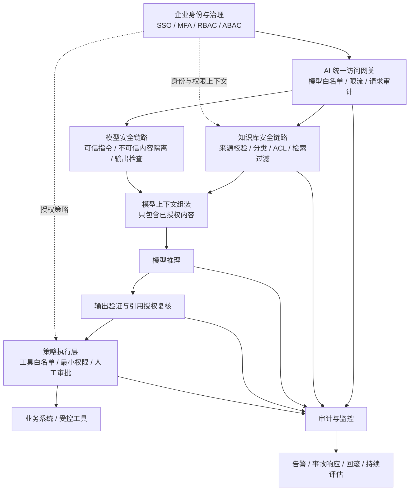

# 安全架构与信任边界

## 1. 目标

保护企业内部 AI 平台、RAG 知识库、模型接入层、会话与缓存、工具连接器及审计系统，防止未授权访问、提示注入、敏感数据泄露和未授权操作。

## 2. 逻辑架构

## 3. 信任边界

### 3.1 身份边界
- 用户身份由企业身份提供方验证。
- 管理员、普通用户、服务账号和 Agent 使用不同身份。
- 不以模型自行生成的用户标识或角色声明作为授权依据。

### 3.2 知识库边界
- 所有导入文档、网页、邮件、附件和用户上传内容均视为不可信输入，除非经过明确的来源与完整性验证。
- 文档 ACL 应从权威源系统同步，向量分块必须携带可验证的授权元数据。
- 在内容被送入模型之前执行服务端授权过滤。
- 引用链接、缓存、摘要、会话记忆、导出文件和派生索引也必须受到权限控制。

### 3.3 模型边界
- 模型不负责授予自己权限。
- 提示词中的安全要求不能替代访问控制、数据隔离或工具权限校验。
- 对模型输入、输出和工具参数执行与风险相适应的验证。
- 模型、版本、系统提示模板和安全策略均纳入版本管理。

### 3.4 工具执行边界
- 模型提出的工具调用应视为待审查请求。
- 可信策略层验证身份、权限、参数、业务约束和风险等级后，才允许执行。
- 付款、交易、删库、批量导出、对外发送敏感数据等高影响操作必须采用独立授权或人工确认。
- 使用最小权限凭据、隔离执行环境、操作限额和幂等控制。

### 3.5 日志边界
- 日志需要防止未授权读取和篡改。
- 不默认记录完整敏感提示词、机密正文、访问令牌或个人敏感信息。
- 对日志字段进行分级、脱敏、访问控制和保留期限管理。

## 4. 失败关闭策略

当身份服务、授权服务、策略引擎或必要的安全检查不可用时：
- 敏感知识检索默认拒绝；
- 高影响工具调用默认拒绝；
- 不得自动切换到不检查权限的备用路径；
- 记录失败原因并触发告警；
- 通过受控恢复流程重新开放服务。

## 5. 设计审查问题

- 是否存在模型可直接访问而不经过授权层的数据源？
- 是否可能通过缓存命中、引用链接或摘要绕过 ACL？
- 文档删除或撤权后，索引、缓存、会话和派生数据如何失效？
- 工具调用是否使用独立身份，且权限范围足够小？
- 是否能够从请求 ID 追溯身份、检索来源、策略判定和操作结果？
- 模型或供应商不可用时，系统是否仍能安全降级？
